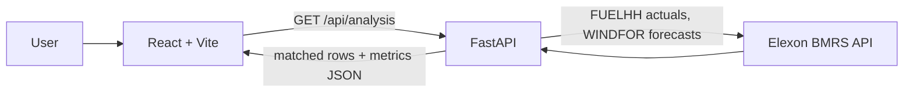

# WindLens

WindLens is a small React and FastAPI application for comparing UK wind-generation forecasts with recorded generation over January 2026. It shows forecast errors by period and summary accuracy measures. This historical view can help a procurement team understand the uncertainty in day-ahead wind estimates when planning electricity purchases; it does not make procurement decisions.

## Features

- Select a delivery date range within January 2026 and a UK-local decision cutoff hour.
- Compare half-hourly actual wind generation with an hourly WINDFOR forecast mapped to each half-hour in that hour.
- View MAE, RMSE, signed forecast bias, and matched-period coverage. MAPE is returned by the API but is not shown in the dashboard.
- Explore an actual-versus-forecast chart, a period error table, and forecast accuracy summaries, including daily MAE and largest errors.
- Export the returned comparison rows as CSV, including rows without a matched forecast.
- Browse Overview, Forecast accuracy, and Historical data views. These are views over the selected January 2026 analysis, not separate historical archives.

See [Data methodology](docs/DATA_METHODOLOGY.md) for the precise selection and alignment rules and [API reference](docs/API.md) for the response schema.

## Screenshots and live demo

- **Frontend:** [https://windlens-5sme.onrender.com](https://windlens-5sme.onrender.com) (URL supplied for this project; deployment status not checked as part of this documentation update)
- **Backend health:** [https://windlens-api-rvo8.onrender.com/api/health](https://windlens-api-rvo8.onrender.com/api/health) (URL supplied; not live-verified)
- **Backend API docs:** [https://windlens-api-rvo8.onrender.com/docs](https://windlens-api-rvo8.onrender.com/docs) (URL supplied; not live-verified)
- **Screenshot:** _Add a screenshot here._
- **Unlisted YouTube demo:** _Add the unlisted demo URL after recording._

## Architecture

The browser loads the Vite-built React application. It calls the FastAPI service at `/api/analysis`; the service requests Elexon BMRS `FUELHH` actuals and `WINDFOR` forecasts, aligns the records, computes metrics, and returns JSON. The browser renders the response and can export its rows to CSV.



More component and request details are in [Architecture](docs/ARCHITECTURE.md).

## Data and methodology

The backend fetches `FUELHH` for actual generation and keeps rows whose `fuelType` is `WIND`; it fetches `WINDFOR` for forecasts. Both datasets use `startTime`, while `WINDFOR` publications also use `publishTime`; generation is read from `generation` and interpreted as MW. Timestamps are parsed as UTC instants (timezone-naive source strings are treated as UTC) and cutoff decisions use `Europe/London`.

For each forecast target timestamp, the backend chooses the record with the latest `publishTime` at or before the selected cutoff on the previous UK calendar day. The cutoff is inclusive through `HH:59:59`; the default hour is 23. It floors the actual timestamp to the containing UTC hour and looks up that hourly forecast, assigning one forecast value to each half-hour in the hour. Periods without a forecast are retained with null forecast, publication, and error values, and excluded from accuracy metrics. Exact details and limitations are documented in [DATA_METHODOLOGY.md](docs/DATA_METHODOLOGY.md).

## Technology stack

- Python 3.12 runtime in the backend Docker image; FastAPI, Uvicorn, HTTPX, and Pydantic (versions pinned in `backend/requirements.txt`).
- React 18, React DOM, Vite 6, Recharts, and Lucide React; TypeScript is listed as a frontend development dependency (see `frontend/package.json`).
- Docker Compose for local container orchestration.
- Elexon BMRS API as the external source.

## Local setup

### Prerequisites

- Python 3.12 recommended (the backend Docker image uses Python 3.12; `backend/.python-version` specifies 3.12.10).
- Node.js and npm. Docker Compose is an alternative workflow.
- Network access to the Elexon BMRS API for live analysis requests.

### Run the backend

From the repository root:

```bash
cd backend
python -m venv .venv
source .venv/bin/activate  # Windows PowerShell: .venv\Scripts\Activate.ps1
pip install -r requirements.txt
uvicorn app.main:app --reload --port 8000
```

### Run the frontend

In a second terminal, from the repository root:

```bash
cd frontend
npm install
npm run dev
```

Open <http://localhost:5173>. The frontend defaults to `http://localhost:8000` in development. API docs are at <http://localhost:8000/docs>, and health is at <http://localhost:8000/api/health>.

### Run with Docker Compose

With Docker Desktop installed, run from the repository root:

```bash
docker compose up --build
```

Open the same local URLs above. Compose starts the backend and Vite development server. Its `VITE_API_URL` setting is not read by the frontend; local requests work because the frontend falls back to `http://localhost:8000` when `VITE_API_BASE_URL` is unset.

## Configuration

| Variable | Used by | Default / configured value | Purpose |
| --- | --- | --- | --- |
| `VITE_API_BASE_URL` | Frontend | `http://localhost:8000` fallback; `frontend/.env.production` points to `https://windlens-api-rvo8.onrender.com` | Base URL for browser API requests. Set it in the frontend environment before building for deployment. |
| `CORS_ORIGINS` | Backend | `http://localhost:5173,https://windlens-5sme.onrender.com`; Compose overrides to `http://localhost:5173` | Comma-separated allowed browser origins. |
| `ELEXON_API_BASE` | Backend | `https://data.elexon.co.uk/bmrs/api/v1` | Base path for Elexon BMRS dataset requests. |
| `VITE_API_URL` | Compose only | `http://localhost:8000` | Present in `docker-compose.yml` but not read by application code; use `VITE_API_BASE_URL` to configure the frontend. |

For local backend overrides, export variables in the shell before starting Uvicorn. For local frontend overrides, define `VITE_API_BASE_URL` in the frontend environment (Vite exposes `VITE_` variables to browser code). The checked-in `frontend/.env.production` contains the supplied Render API URL. No credentials are required by the implementation. Render dashboard values are not present in this repository, so the deployed settings cannot be verified here.

## API

The implemented endpoints are `GET /api/health` and `GET /api/analysis`. FastAPI's interactive schema is available at `/docs`. For query constraints, response fields, examples, and error behavior, see [API.md](docs/API.md).

Example:

```bash
curl 'http://localhost:8000/api/analysis?start_date=2026-01-01&end_date=2026-01-02&cutoff_hour=23'
```

## Deployment

The repository contains a production frontend API base URL in `frontend/.env.production` pointing to the supplied Render backend URL. The listed public URLs indicate the intended Render arrangement: a static frontend and a Python API service. No Render service manifests or dashboard configuration are present, and this task did not deploy or check the services.

For a Render setup, configure the frontend build with `VITE_API_BASE_URL=https://windlens-api-rvo8.onrender.com` and configure the backend `CORS_ORIGINS` to include `https://windlens-5sme.onrender.com`. Redeploy each service after changing its code or build-time/runtime configuration. Confirm the actual Render build and start commands in that service's settings; they are not specified in this repository. The backend container's start command is defined in `backend/Dockerfile`.

## Testing and validation

No automated test files or test scripts are present in the repository. The frontend defines `npm run build`; the backend has no test command configured. A manual smoke check can start the two local servers, open the UI, run a January analysis, inspect `/api/health` and `/docs`, and verify that CSV export downloads. These are suggested checks, not checks performed for this documentation update.

## Project structure

```text
windlens-starter/
├── backend/
│   ├── app/
│   │   ├── __init__.py
│   │   └── main.py
│   ├── .python-version
│   ├── Dockerfile
│   └── requirements.txt
├── docs/
│   ├── API.md
│   ├── ARCHITECTURE.md
│   └── DATA_METHODOLOGY.md
├── frontend/
│   ├── src/
│   │   ├── main.jsx
│   │   └── styles.css
│   ├── .env.production
│   ├── index.html
│   ├── package.json
│   ├── package-lock.json
│   └── vite.config.js
├── docker-compose.yml
└── README.md
```

## Limitations and future work

- Add automated tests for cutoff boundaries, timezone conversion, matching, metric calculations, and missing records.
- Validate the forecast cutoff and source field assumptions against the assignment owner and current BMRS behavior.
- Consider caching, retries, and more explicit upstream error handling for repeated or unavailable data requests.
- The dashboard's date controls and backend validation cover January 2026 only.
- WINDFOR is used at hourly resolution and repeated across two half-hour actual periods; there is no interpolation or downscaling.
- Coverage counts matched rows relative to the actual periods returned for the selected window; missing actual records are not imputed.
