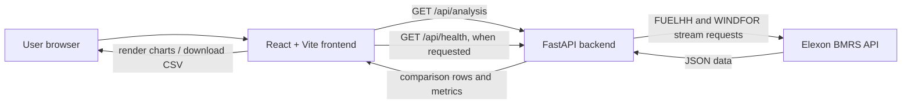

# Architecture

## System overview

WindLens has a browser frontend, a Python API, and Elexon BMRS as its external data provider. The frontend is a React application bundled and served in development by Vite. The API is a FastAPI application running under Uvicorn. Docker Compose provides a local development setup; the backend also has a Dockerfile.



## Component responsibilities

### Frontend

`frontend/src/main.jsx` owns the date and cutoff controls, calls the API, displays errors, and renders the overview and accuracy views. It filters the comparison rows for charting and computes some display-level summaries such as daily metrics, error distribution, and largest errors. CSV export serializes all API rows, including unmatched rows. React, React DOM, Recharts, and Lucide React are runtime dependencies. Vite and its React plugin handle development and bundling.

`VITE_API_BASE_URL` selects the API base URL; the code falls back to `http://localhost:8000`. `frontend/.env.production` sets the supplied production API URL.

### Backend

`backend/app/main.py` defines `/api/health` and `/api/analysis`. The analysis handler requests `FUELHH` and `WINDFOR` concurrently with HTTPX, normalizes the timestamped source rows, selects one eligible forecast per target, aligns forecasts to actual periods, and calculates metrics. FastAPI provides query validation and OpenAPI docs.

### External source

The backend calls Elexon's `/datasets/{dataset}/stream` endpoints for `FUELHH` and `WINDFOR`. `ELEXON_API_BASE` controls the API base path. No source data is stored in a local database or cache in this implementation.

## Request and data flow

```mermaid
sequenceDiagram
  participant B as Browser
  participant F as FastAPI
  participant E as Elexon BMRS
  B->>F: GET /api/analysis?start_date&end_date&cutoff_hour
  F->>E: FUELHH stream, settlement date window
  F->>E: WINDFOR stream, publication time window
  E-->>F: JSON rows
  F->>F: Filter WIND actuals; select eligible forecasts
  F->>F: Match hourly forecast to containing actual half-hour periods
  F->>F: Calculate matched-period metrics
  F-->>B: Period metadata, counts, metrics, rows
  B->>B: Render charts/tables or export rows as CSV
```

The actual request filters use `settlementDateFrom` and `settlementDateTo`. The forecast request spans from midnight UTC on the day before the requested start through the end of the requested end date in UTC. The backend also filters actual instants into the requested local date window and emits rows for actual timestamps it receives.

## Environment and deployment configuration

| Setting | Read from | Purpose |
| --- | --- | --- |
| `VITE_API_BASE_URL` | Frontend build environment | API origin used by browser requests; fallback is localhost port 8000. Production env file contains the supplied Render API URL. |
| `CORS_ORIGINS` | Backend process environment | Comma-separated origins accepted by CORS middleware. Default includes localhost and the supplied frontend URL. |
| `ELEXON_API_BASE` | Backend process environment | Elexon API base URL; default is `https://data.elexon.co.uk/bmrs/api/v1`. |
| `VITE_API_URL` | Docker Compose environment only | Set in Compose but unused by the frontend code. The dev frontend currently works through its localhost fallback. |

Compose maps backend port 8000 and frontend port 5173. It sets backend CORS to localhost. The repository supplies the public Render URLs and a production frontend API URL, but it does not contain Render service manifests or dashboard settings. Therefore, the exact deployed service configuration and current availability are not verified by these files.

## Design decisions and limitations

- Analysis dates are explicitly restricted to January 1–31, 2026 in the API, and the frontend date input bounds match that range.
- Forecast cutoff is a UK calendar date and hour. The selected cutoff includes that hour through minute 59, second 59. For each `startTime`, the latest eligible `publishTime` is retained.
- Forecast timestamps are hourly; the backend floors an actual UTC timestamp to the hour and uses that forecast for the actual period. It does not interpolate forecasts to half-hour resolution.
- Source values are converted to floating-point numbers; malformed generation values and timestamps are skipped. Duplicate timestamp keys in normalized dictionaries are overwritten by later source rows encountered.
- Unmatched forecasts are represented by null fields and excluded from metrics. No missing actual periods are synthesized.
- There is no caching, persistence, pagination, retry policy, authentication, or automated test suite in the repository.
- Upstream HTTP and unexpected data-shape errors become HTTP 502 responses. Other unhandled exceptions use FastAPI's normal server error handling.

